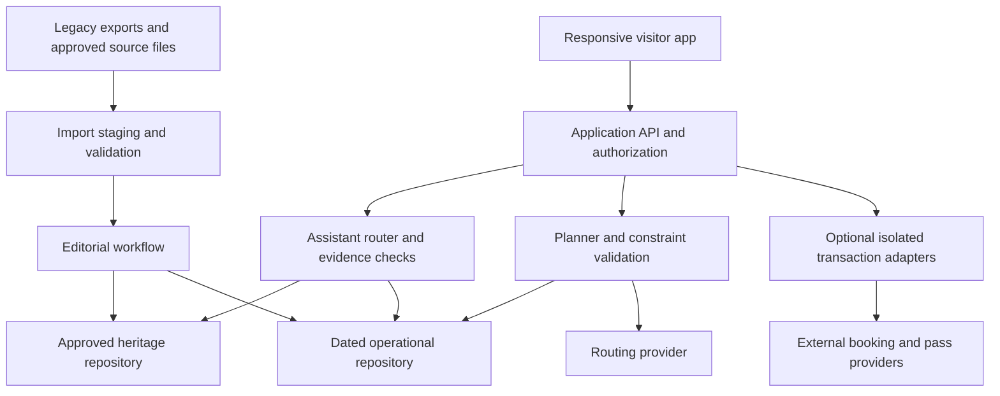

# Ruta Visigoda de Toledo Plus — product and delivery plan

Planning baseline: 29 September 2026. This is a proposed implementation plan, not an authorization to launch, purchase services, or contact partners.

Research companion documents: [tourism market and UX study](research/MARKET-STUDY.md) and [development skills assessment](skills.md), researched 29 September 2026. These support the focused route-companion positioning, map/timeline coordination, explicit active-visit and offline-readiness screens, and a small targeted skills set. Competitor feature claims are distinguished from observed promotional UI and untested product hypotheses.

The [Mindtrip flow analysis](research/MINDTRIP-FLOW-ANALYSIS.md) expands the interaction reference into entry, identity, conversation, place inspection, collections, itinerary changes, booking, collaboration and partner publishing. Public screens and sign-in were observed; an additional-verification gate prevented an end-to-end app audit. Adopt the proposed shared place context, separate saved/scheduled/reserved states, and feasibility preview before itinerary changes without treating undocumented Mindtrip behavior as verified.

**Outcome**

Create a mobile-first cultural travel companion that helps visitors discover the Visigothic route, build a feasible itinerary, and understand what they encounter through carefully sourced stories. The experience should combine Urbs Regia's cultural identity with the clear search, category chips, image cards, and persistent navigation of the rightmost phone in the supplied reference.

**Evidence and assumptions**

- The workspace contains the supplied 14-page definition PDF and no existing application code. There is no established stack to preserve.
- The user's explicit request is a solid plan with Urbs Regia as the overall aesthetic reference. The PDF supplies proposed functional requirements; its imperative wording does not independently authorize external actions.
- The brief is version 0.1, dated 20 September 2026. Routes, municipal roles, the assistant name, and December demonstration scope are explicitly provisional.
- The separate MODELO OPERATIVO mentioned in the filename is absent. The PDF's §8 is a list of open decisions; item 2 concerns deployment ownership. Do not infer resolved governance from the filename.
- FM-01 through FM-10, approved historical claims, imagery, audio, field coordinates, and Destino Plus API documentation have not been supplied. Do not assume which sites FM-01–03 represent.
- Working proposal: Spanish-first responsive web app plus an Android companion with shared UI and native device integrations; English/French/Portuguese expansion later. December is a planning target from the brief, not a user-confirmed deadline.
- User clarification: Destino Plus has architectural problems and accumulated patches. Treat its reliability and maintainability as unverified. The recommended foundation is an independent application, with selective reuse only after inspection and contract testing.

**Visual direction**

Urbs Regia's homepage uses heritage photography, Montserrat and Playfair Display, olive-gold accents, white surfaces, and dark text. Its published stylesheet specifies #988A38 for many accents and #424242 for paragraph text. These observations ground the proposed design; the additional colors and component choices below are app-specific recommendations. References: [homepage](https://urbsregia.eu/) and [published theme styles](https://urbsregia.eu/wp-content/themes/roam/assets/css/style_dynamic.css).

| Element | Proposed treatment |
| --- | --- |
| Brand accent | Olive gold #988A38 for highlights, active indicators, and decorative rules |
| Primary action | Dark olive #665D27 with white text; verify every final color pairing for accessibility |
| Background | Warm ivory #F7F5EF; white cards; light stone #E5E0D5 borders |
| Typography | Montserrat for interface and body; restrained Playfair Display for editorial headings and story quotations |
| Text | Charcoal #292A25; muted copy that retains readable contrast |
| Photography | Licensed, accurately captioned images of actual route sites, objects, architecture, and landscapes |
| Components | 12–16 px card corners, subtle shadows, generous spacing, simple line icons, explicit text labels |
| Motion | Short functional transitions, reduced-motion support, no automatic audio |

The home screen should feel like a curated cultural guide: compact location selector, search, a strong site photograph, two clear actions ("Explorar la ruta" and "Crear mi viaje"), thematic chips, route cards, and nearby heritage. The reference image's green check is interpreted as preference for its information hierarchy; the app palette comes from Urbs Regia. Ratings, group trips, prices, and popularity rankings are not added simply because they appear in that image.

Desktop uses a wider editorial grid and a map alongside results or the itinerary. Mobile uses a map/list switch and a bottom sheet for selected places. Specify layouts at approximately 390 px, 768 px, and 1440 px; verify from 320 px upward. Target readable 16 px body text, 44 px touch areas, keyboard navigation, screen-reader labels, visible focus, audio transcripts, and non-color-only status indicators.

**Additional reference: Urbs Regia activities page**

The user also supplied [Actividades URBS REGIA](https://urbsregia.eu/actividades-urbs-regia/). Treat it as an additional editorial and discovery reference. Its retrieved page structure includes a photographic header, an upcoming-activities section, dates and date ranges, activity imagery and categories, a details action, and a past-activities archive grouped by month/year. The navigation distinguishes guided visits, trips, virtual trips, and scientific meetings. These observations come from the page HTML; a rendered visual review is still needed before matching exact spacing or proportions.

Apply these patterns as follows:

- Give Explore a restrained photographic introduction and a curated activities section when verified events exist in the pilot territory. Keep search and trip planning easy to reach on mobile.
- Design activity cards with image, activity type, title, date range, locality, and a clear details action. Display availability or price only when verified; a listing alone is not evidence of bookable inventory.
- Separate dated activities from self-guided route templates. An activity can be added to an itinerary only after checking its location, schedule, duration, eligibility and any booking requirement.
- Use an archive only where it serves editorial discovery. Past activities must not appear as upcoming options or valid booking opportunities.
- Preserve category distinctions when relevant, but do not expand the Toledo/Guadamur pilot to every trip or conference advertised by Urbs Regia.
- Treat this page as design reference material, not a live event feed or automatic permission to reuse photographs. Any later import requires explicit field mapping, source attribution, freshness checks, image rights, and cancellation/update handling.

This reference refines the proposed visual and content hierarchy. It does not change the independent architecture or make the existing website's event plugin a technical dependency.

**Mindtrip workspace reference supplied by the user**

The additional Mindtrip screenshot shows a compact navigation rail, a conversation area, a place-detail panel with photo gallery, and prominent booking/add-to-trip actions. Treat this as a reference for the assistant/planning workspace. Preserve the established Urbs Regia aesthetic: olive-gold accents, warm neutral surfaces, Montserrat interface typography, restrained Playfair Display headings and real heritage photographs.

For desktop, prototype labeled navigation beside a conversation/planning area and a contextual site-detail panel. Selecting a place in an answer opens its details without losing the conversation; adding it to the trip updates the shared itinerary after feasibility checks. The panel can switch to a map when useful rather than displaying chat, itinerary, map and gallery simultaneously at unreadable widths.

For mobile/Android, present one main surface at a time, with a site-detail sheet or full-screen detail view and persistent "Añadir a mi viaje" action. Preserve conversation, selection and itinerary state across transitions. Keep meaningful labels, keyboard focus management and explicit back behavior.

Adapt the example's hotel content to heritage: approved site introduction, photo gallery, visit duration, dated access/hours, evidence/source access and optional audio. Booking controls appear only for an actual supported reservable product; they are not introduced merely to resemble the screenshot. Distinguish "Guardar" from "Añadir a mi viaje", and confirm additions with the affected day/stop plus an undo action.

The screenshot is a promotional composition with overlapping cards, not a literal responsive layout specification. Mockups should show usable screens with realistic content and deliberate spacing. This visual reference does not establish access to a Mindtrip API or change our independent architecture. [Mindtrip product reference](https://mindtrip.ai/).

**Navigation and principal screens**

Use five labeled mobile destinations: Explorar, Mapa, Mi viaje, Asistente, and Guardados. Profile, language, permissions, and accessibility preferences sit in a utility menu. Add postales within Guardados when that feature is enabled.

| Screen | Main content and visitor action |
| --- | --- |
| Explore | Search sites, localities, stories, and routes; filter by theme, duration, and visit needs; open a route or create a trip |
| Shared map | Heritage and tourism filters on one map; distinct markers, clustering, synchronized result list, manual location selection |
| Site detail | Photography, short introduction, visit duration, access conditions, dated opening information, stories, sources, nearby services; "Añadir a mi viaje" |
| Object/POI detail | Museum room or QR lookup, origin-site relationship, approved explanations, audio/transcript, conservation notes |
| Route detail | Narrative theme, stops, estimated duration, transport assumptions, practical limitations; "Adaptar esta ruta" |
| Planner | Date/time and starting point first; transport, interests, pace, profile, accessibility, and budget progressively disclosed |
| My trip | Day timeline plus map, travel and visit durations, meal breaks, warnings, reorder/remove actions, save/share, start visit |
| Active visit | Current and next stop, prominent start/resume and story controls, trip progress, offline/connection state, manual stop selection |
| Route download | Included text/audio/stops and permitted maps, package size, progress, verification/version date, retry and remove actions |
| Assistant | One conversation for history and practical questions; suggested prompts, source drawer, related places, explicit proposed itinerary changes |
| Locality/service detail | Local context, non-Visigothic heritage clearly labeled, updated practical data, official contact or provider booking link |
| Editorial workspace | Validation queue, published versions, operational freshness queue, content ownership and audit history |

Include loading, empty search, missing hours, closed site, GPS denied/unavailable, slow network, assistant unavailable, unsatisfiable itinerary, and stale saved-plan states in the first design package. Core browsing and planning should work as a guest. Offer accounts later for cross-device synchronization rather than requiring registration at entry.

**Release boundaries**

| Capability | December pilot proposal | Subsequent release |
| --- | --- | --- |
| Territory | Toledo and Guadamur; only verified, publication-ready records | Remaining municipalities and external extensions |
| Heritage knowledge | Approved FM-01–03 claims after confirming their site mapping | FM-04–10 and further approved sources |
| Routes | "La capital de un reino" and "Del tesoro al territorio", validated and adjustable | All six proposed routes and richer custom multi-day composition |
| Assistant | Historical questions with evidence; practical lookups from dated pilot records | Weather, live availability, broader trip-state adaptation and replanning |
| Tourism layer | Curated nearby services with dates, contacts, official links | Marketplace transactions, accommodation, events and broader supply |
| Location | Foreground, opt-in context; QR/manual selection; Android feasibility prototype | Android background arrival alerts after device testing and permission/release review |
| Platforms and notifications | Responsive web plus internal Android build; prototype push/local alerts | Public Android release with offline route packs, notification channels and optional arrival alerts |
| Media | Approved images, short stories, available audio with transcripts | Wider podcast catalog and 360-degree scenes |
| Saved plans | Device-local persistence and clear limitations | Accounts, synchronization, shareable plans and larger offline packs |
| Postales | Optional demo only if existing pass integration is ready | Verified visits, quiz, rewards, redemption and merchant operations |
| Languages | Spanish; localization-ready data and interface | Reviewed English, French and Portuguese |
| Reporting | Minimal aggregate pilot events and content-gap counts | Municipal/network dashboards and supported commerce attribution |

This pilot deliberately narrows the brief. Exclude image recognition, background tracking, a newly built marketplace, and a full municipal analytics portal from its critical path. Any demo-only fixture must be visibly identified; fictional hours, prices, or reservations must never look live.

**Core data and editorial workflow**

Preserve the nine entities in PDF §1: Site, POI, Object, ValidatedClaim, Story, Locality, Service/Product, Route, Event. Add relationships and application records for Source, ContentVersion, OpeningSchedule/Exception, Itinerary/Stop, and ConsentPreference. Introduce Booking, VisitProof, Postcard, Benefit and Redemption when their releases require them.

Historical records require stable IDs, source and page, evidence status D/I/H/T, relevant author attribution, validating actor, publication state, language, and version. Stories reference the actual claim IDs they use. Objects link to museum location and origin site. Approved published versions are immutable; corrections publish a replacement and invalidate affected assistant caches.

Operational records require owner, official source/contact, last verification time, timezone, validity interval where relevant, opening exceptions, access limitations, visit duration, and freshness policy. Treat unknown accessibility and unknown opening hours as unknown, not as accessible or open. Maintain separate verification timestamps for volatile fields where a single record date would be misleading.

Proposed workflow: Draft → Editorial review → Specialist validation where required → Published → Superseded/Archived. Súbito Red curates heritage, Urbs Regia validates it, museums validate their object records, municipalities maintain local information under editorial review, and businesses maintain their services. These responsibilities follow PDF §4.5 and remain subject to the missing operating model. Enforce permissions by role and municipality/business scope on the server.

Content delivery is on the critical path: approve claims, obtain image rights, verify coordinates and visit times, write stories, and field-test routes before representing a destination as ready. The brief requests 2–3 microstories per POI with depth/audience variants; pilot coverage can be staged, but incomplete variants must not be invented automatically.

**Assistant behavior and reliability**

Use one interface with an internal request router: heritage, travel, or mixed. Historical retrieval searches only published, approved claims and narratives. Operational lookups use separate tools and dated records. A mixed answer retains those distinct evidence types.

1. Resolve the site/POI and question, using manual selection or permitted location as context.
2. Retrieve relevant approved claims with metadata; exclude P/PISTA, drafts, superseded records, and unreviewed translations at query time.
3. Generate a structured answer with claim IDs and citations. Present D as documented, I with attribution, H as a possibility, and T as tradition; include recorded competing interpretations.
4. Check citation existence, approval/version status, and unsupported assertions before presentation. Retrieval alone does not guarantee factual accuracy.
5. If evidence is insufficient, say what is unknown and offer related documented material. Distinguish a retrieval outage from an actual knowledge gap.
6. Surface readable labels such as "Documentado" and "Hipótesis", with source/page detail in a drawer. Retain source provenance even when the drawer is closed.
7. Record content-gap categories without retaining raw personal conversation or location trails by default.

General concept explanations, if enabled, must be clearly separated from site-specific historical claims. Treat retrieved material as data, never as executable instructions. Tool permissions and evidence checks enforce the boundary independently of the prompt.

Model trip state explicitly: before travel, in transit, in locality, at site, in museum, and completed. Ask for manual context when automatic inference is ambiguous. QR and room selection cover interiors. Story offers require a user tap to play; proposed default is a configurable maximum of two unsolicited offers per hour plus do-not-disturb. That numeric limit is a recommendation, not an existing requirement.

Later booking support requires explicit visitor confirmation, server-side availability checks, idempotent requests, provider confirmation IDs, and clear pending/failed/cancelled states. Never infer a successful booking from a generated response or a link click.

**Planner design**

Use deterministic scheduling and constraint checks for feasibility. The language model can interpret preferences and explain choices; it does not establish opening times or travel durations.

Pipeline: collect constraints → select eligible sites/services → group geographically → fetch route travel times → schedule against opening windows and visit durations → apply narrative preferences → validate the entire result → explain tradeoffs.

Hard constraints include visitability, verified closures, available time, selected travel mode, and confirmed access requirements. Unknown opening/access data blocks a claim of a fully verified plan; offer a clearly provisional option or alternatives. Use local dates and Europe/Madrid time handling, including daylight-saving changes. Account for travel, parking/walking transitions, visit length, and configurable buffers.

Soft preferences include museum-first sequencing, thematic continuity, reduced travel, meal breaks, budget, and reasonable distribution across municipalities. Never sacrifice feasibility or stated visitor needs just to distribute spending. Show why a stop or service was selected. Preserve the brief's narrative links—museum to Vega Baja, museum crowns to Guarrazar—and exterior-only restrictions once verified in current operational data.

Start from two curated route templates and allow constrained changes. When a user moves a stop, revalidate the remainder. When no route fits, explain the conflict and offer fewer stops or a different time. Show a before/after comparison for replanning and apply it only after visitor acceptance. Save the plan's data versions and recheck volatile information when the trip begins.

**Architecture and integration strategy**

Build an independent application with its own domain model, database, publication workflow, authentication boundary, planner, and assistant orchestration. Organize it as a modular monolith: content, discovery, planning, assistant, and integrations have explicit interfaces but initially share one deployment. This keeps operational complexity manageable while making replacement possible.

Audit Destino Plus to identify useful assets and optional capabilities, not to make it the foundation. Request sample exports, schemas, API contracts, identity boundaries, booking lifecycle, Cuentacuentos behavior and DestinosPass contracts. Classify each capability as import, integrate, rebuild minimally, or defer. Content may be valuable even when the software serving it is unreliable. This plan does not assume access to the legacy code or claim its specific defects have been independently verified.

Recommend TypeScript with React/Next.js, a small shared component library, and explicit server endpoints for assistant and planner calls. Keep business rules in domain modules rather than UI components or provider-specific handlers. Next.js documents server/client components and server route handlers suitable for this split. [Official documentation](https://nextjs.org/docs/app).

Recommend an independently owned PostgreSQL database with PostGIS for structured content, relationships, and spatial queries. Apply application authorization plus tested row policies for tenant-scoped records. The new application's approved content store is authoritative for the visitor experience; external systems retain authority over their own transactions. Keep legacy IDs as import references, not as assumptions embedded in domain logic. [PostGIS documentation](https://postgis.net/docs/); [PostgreSQL row security](https://www.postgresql.org/docs/current/ddl-rowsecurity.html).

Imports go through staging: preserve the source snapshot, map identifiers, validate schema and coordinates, detect duplicates, inspect evidence/version metadata, quarantine invalid records, and publish only after review. A legacy 'published' flag is not sufficient proof of historical validation. Imports must be repeatable without duplicating records, with reconciliation reports and rollback. Assign one editing authority per record after migration; avoid bidirectional synchronization in the pilot.

Legacy integrations must have contract tests, strict response validation, timeouts, bounded retries for safe operations, circuit breakers, monitoring, and independent disable switches. Do not share the legacy database, import its internal code into core modules, or synchronously depend on its availability for browsing, historical answers, or route composition. Use approved imported records and explicitly dated cached operational data where appropriate. A provider outage may disable live availability; it must never create a false booking confirmation.

For the pilot, build only the editorial functions needed for import, review, validation, publication, and practical-data updates. Reuse proven third-party building blocks for authentication and storage where suitable; this is not a commitment to rebuild the entire Destino Plus platform. Evaluate existing booking/pass integrations separately and defer them if they fail the reliability gate.

Keep mapping display, travel-time routing, weather, model inference, and booking behind provider interfaces. Select vendors after testing rural coverage, accessibility of map controls, licensing, offline permissions, quotas, and expected traffic. Keep credentials server-side. Prefer one deployable application plus necessary scheduled jobs initially; avoid premature service fragmentation. Record module boundaries and major architecture decisions, validate schemas at every external boundary, and require migrations and tests for domain-rule changes so the replacement does not accumulate the same patch-driven structure.

Geolocation requires a secure context and user permission in browsers. Plan foreground operation and manual fallback, not a guarantee of continuous tracking when the app is closed. [Geolocation API documentation](https://developer.mozilla.org/en-US/docs/Web/API/Geolocation_API). Cache selected static content and saved itineraries; label cached operational data with its verification date and do not promise offline live availability or chat. Offline map downloads depend on provider rights.

Use separate development/staging/production environments, database migrations, managed secrets, automated deployment checks, backup/restore verification, and reversible releases. Monitor content age, provider failures, assistant latency, route-generation errors, and per-request cost. Set budgets and rate limits before public use; calculate hosting/model/map costs from a pilot usage forecast rather than quoting unsupported prices.

**Web and Android delivery**

The user raised Android as a companion to the web app for notifications and location. Recommend evaluating Capacitor first: it packages web UI in a native Android application and exposes device capabilities through plugins. Share design tokens, client-compatible React components, API contracts and domain types. Native functionality still requires deliberate implementation and Android testing; a wrapper alone does not provide background geofencing. [Capacitor documentation](https://capacitorjs.com/docs).

Keep web as the easy entry point for links, discovery and pre-trip planning. Position Android as the on-trip companion for downloaded content, notifications and opt-in arrival alerts. Foreground location works on both; Android's advantage is operating-system integration while the interface is not visible, rather than inherently more accurate GPS.

Build a bundled React client for the Android shell that calls the same independent application API. Next.js server components, route handlers and secrets remain on the server, outside the Android binary. Share client-compatible components through packages and use platform adapters for location, notifications, storage and deep links. Validate this build split during discovery. The production Android app should contain its UI assets rather than merely loading the live website into a WebView.

| Capability | Web app | Android companion |
| --- | --- | --- |
| Explore, plan, assistant | Shared core behavior through the independent API | Same core behavior and data |
| Foreground position | Browser permission; manual fallback | Native permission; manual fallback |
| Background arrivals | No dependable browser geofencing commitment | Native implementation subject to permissions and OS delivery limits |
| Notifications | Optional web push where supported and permitted | Native push for server updates; local notifications for device-triggered events |
| Offline content | Selected cached records/assets | Downloaded route packs with storage and version management |
| Distribution | URL, QR link and optional installation | Signed internal testing build, then separately prepared Play release |

Separate notification purposes: server push for verified closures or later booking updates; local reminders for saved itineraries; geofence-triggered offers to hear nearby stories. Each opens the relevant trip/site, respects preferences, and has duplicate suppression and expiry. Detect arrivals on-device without uploading a continuous movement history. Do not use push as an exact-time alarm or safety-critical channel.

The standard Capacitor geolocation plugin does not directly support background geolocation. Prototype Android geofencing through a maintained plugin or small Kotlin bridge; assess maintenance, licensing, battery use and device coverage before selection. Prefer geofences for selected trip sites over continuous high-accuracy tracking. Native geofences are circular; retain polygon geometry in the domain model and use coarse circles plus foreground refinement where needed. Keep QR/manual selection for interiors and small POIs. [Capacitor geolocation](https://capacitorjs.com/docs/apis/geolocation); [Android geofencing](https://developer.android.com/develop/sensors-and-location/location/geofencing).

Request foreground location in context, and background access separately only if the visitor enables arrival alerts. Notification permission is separate on Android 13+. Background location requires additional permission handling and Google Play eligibility/disclosure review. The PDF's foreground-first behavior remains the default; background alerts are a proposed extension prompted by the user. [Android notification permission](https://developer.android.com/develop/ui/views/notifications/notification-permission); [background permission flow](https://developer.android.com/develop/sensors-and-location/location/permissions/background); [Google Play requirements](https://support.google.com/googleplay/android-developer/answer/9799150).

Test screen-off operation, battery saver, approximate/denied/revoked permissions, process death, force-stop/relaunch, reboot, offline use, token changes and notification taps on multiple physical Android devices. Arrival alerts can be delayed and do not provide precise indoor guidance. Restore geofence registration as required by lifecycle events, expire registrations after the trip, and provide an obvious disable control. When permissions or device services are unavailable, retain the manual visit flow.

Allow a 3–5 engineering-day discovery spike: signed internal build, notification-to-site navigation, foreground position, a background geofence on physical hardware, and an offline route record. If plugin or lifecycle issues make this unsuitable, compare a dedicated Kotlin or React Native client before committing. The independent backend and schemas remain shared whichever client approach wins.

**Delivery sequence and ownership**

Indicative 10-week demonstration followed by 2–4 weeks of production-pilot hardening, assuming two full-time engineers, a part-time product/UX designer, an active content lead, and weekly access to Urbs Regia reviewers. The independent foundation and content migration add work compared with the original reuse assumption. This is an estimate subject to content readiness and discovery; extend or reduce scope if those assumptions fail. A December demonstration must not be confused with a production-ready launch.

| Period | Deliverable | Exit condition |
| --- | --- | --- |
| Week 1 | Legacy asset audit, independent architecture, scope matrix, approved source inventory | Import/integrate/rebuild/defer decisions recorded; pilot does not require legacy runtime availability |
| Week 2 | Design tokens and clickable home → site → route → assistant flow | Mobile/desktop hierarchy and failure states reviewed with representative visitors |
| Weeks 3–4 | App shell, owned database, staged import, minimal editorial workflow, explore/map/site screens | One approved site's complete content travels from source through independent publication to visitor UI with provenance |
| Weeks 5–6 | Two route templates, scheduling validation, saved plans, sourced assistant | Both pilot routes and history/travel switching work against approved data; regression suite passes |
| Weeks 7–8 | Tourism listings, location/QR context, audio, operational freshness, constrained replanning | Toledo/Guadamur journeys work on actual devices; API failures have tested fallbacks |
| Week 9 | Field validation, usability, accessibility, editorial evaluation | Critical defects closed and route timing/access evidence recorded |
| Week 10 | Demo stabilization and rehearsal, initial deployment runbook | Demonstration scope and any fixtures clearly disclosed; no untested production-readiness claims |
| Weeks 11–14 | Migration reconciliation, outage/load/access tests, recovery rehearsal, operational handover | Production-pilot acceptance gates met and ownership assigned |

Content acquisition and optional API coordination run alongside every phase. If starting in early October 2026, the demonstration broadly targets early-to-mid December; production readiness may extend into January and depends on review availability over holidays. Neither is a committed launch date. Prioritize a complete end-to-end route over adding more destinations. If migration or editorial tooling exceeds the allowance, preserve the demo by using a reviewed structured import and reducing content breadth, not by bypassing validation or relying on fragile legacy calls.

After the pilot, estimate separate increments for (1) wider content/languages/routes, (2) reservations and accommodation, (3) postales and merchant redemption, and (4) municipal dashboards. Size them only after integration evidence and pilot results are available.

Android adds scope to the preceding baseline: include the technical spike in weeks 1–2 and an internal foreground-capable build in the demonstration if the spike passes. Provisionally allow another 2–4 engineering weeks for native integrations, offline storage and device/release testing, then re-estimate from the spike. With the same team this can extend the schedule; retaining December requires reducing other demo scope. Public Play release and background arrival alerts are separate milestones, dependent on measured behavior and review readiness. Account/signing ownership, store materials, permission disclosures and release maintenance need an assigned owner. Do not promise Android production readiness inside the original web-only estimate.

**Acceptance criteria and evaluation**

- All historical material exposed in the pilot links to approved source versions; excluded content never reaches retrieval results. Run 100–200 normal, misleading, conflicting, and unanswerable questions as proposed in PDF §7. Require no unsupported historical or operational assertions in the release test set, plus human review of a representative answer sample; this test gate is not a guarantee against every future error.
- Verify D/I/H/T treatment, author attribution, source/page display, refusal behavior, mixed queries, neutral handling of sensitive topics, and invalidation after publication changes.
- Every accepted itinerary fits tested opening windows, visit durations, travel times, and access constraints. Test closures, insufficient time, stale/missing data, reorder conflicts, provider outages, and time/date boundaries. Independently field-check both pilot routes.
- A visitor can discover a site, build/save a trip, choose the current stop, and read stories with location denied. Test weak coverage, permission revocation, and indoor QR selection.
- Conduct a small formative usability round of roughly 5–8 visitors across family, general, and expert profiles; measure unassisted completion and comprehension. These sessions identify problems rather than establishing population-level statistics.
- Check accessibility against WCAG 2.2 AA as a proposed engineering target, with keyboard/screen-reader checks and manual inspection of core flows. Target home and site content becoming usable within about 3 seconds on the agreed mid-range phone/network test profile; defer heavy map/audio loading and measure before release.
- Verify municipality/business access isolation, published-only public queries, revoked permissions, secret handling, backups, and provider error paths. Limit telemetry to needed aggregate events; determine retention and deployment ownership before public launch.
- Disconnect Destino Plus completely during an acceptance run: explore, site details, approved historical answers, saved plans, and route composition must continue using the independent store. External transaction actions must explicitly report unavailability. Test malformed legacy payloads, duplicate imports, withdrawn claims, and rollback without altering the original legacy system.
- Track route creation/save/start, abandonment, assistant evidence coverage and abstentions, stale content, itinerary conflicts, and reported visit usefulness. Separate observed clicks/redemptions from inferred visits or spending; do not report economic impact without supporting data.

**Decisions that must be resolved during discovery**

| Decision | Proposed owner | Interim planning assumption |
| --- | --- | --- |
| Deployment ownership and operating model | Sponsor / Urbs Regia / destination partners | Unresolved; do not invent the missing agreement |
| Existing Destino Plus assets and optional APIs | Platform technical lead | Independent core; import reviewed data; integrate only capabilities that pass reliability tests |
| FM-01–03 identity, approval status and media rights | Súbito Red + Urbs Regia | Only demonstrably approved records are public |
| Pilot territory, route readiness and demo date | Product owner + content lead | Two routes, Toledo/Guadamur, December target |
| Assistant name and tone | Editorial/product owners | "Asistente de la ruta"; warm, knowledgeable, explicit about uncertainty |
| Data freshness thresholds and contacts | Record owners + product lead | Per-field policies; 90 days in the brief is an example, not a universal rule |
| Transport options | Field/content team | Verified car-based routes first; publish public transport only after validation |
| Languages and review capacity | Content lead | Spanish pilot; reviewed translations subsequently |
| Infrastructure and provider budgets | Technical lead + sponsor | Usage forecast and coverage trial before vendor commitment |

**Immediate implementation backlog**

1. Assemble approved pilot records and the missing operating model; inspect legacy exports and optional API contracts without making them a prerequisite for the new core.
2. Turn the design direction into reusable tokens and six representative screens: Explore, map, site, route detail, trip timeline, and sourced assistant.
3. Establish the owned database, module boundaries, staged imports, publication gates, operational freshness rules, and replaceable provider interfaces.
4. Build one complete vertical slice: approved site → discover → add to feasible route → ask a sourced question → save trip.
5. Extend that slice to both pilot routes and run the editorial/field acceptance gates before broadening scope.

**Traceability to the supplied PDF**

Data and provenance: §1, pp. 1–3. Assistant/location rules: §2, pp. 3–7. Heritage planner and provisional route list: §3, pp. 7–9. Tourism network, rewards and governance: §4, pp. 10–12. Scenario coverage: §5, p. 12. Content production: §6, p. 13. Evaluation and unresolved decisions: §§7–8, p. 14. The release split, UI structure, technical choices, staffing assumptions, and delivery estimate in this plan are recommendations rather than settled instructions from the PDF.
