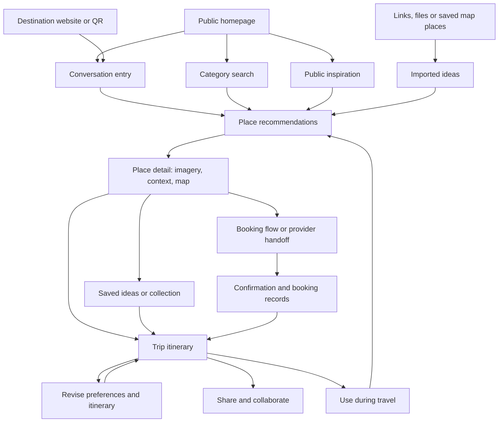
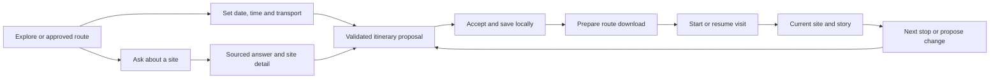

# Mindtrip flow analysis and application to Ruta Visigoda

Research date: 29 September 2026. Related: [project plan](../PLAN.md), [market study](MARKET-STUDY.md).

**Principal finding**

Mindtrip's product direction connects inspiration, conversation, places, collections, itineraries and transactions. The most useful pattern for our project is continuity: a place suggested in conversation should remain the same selectable place in its detail panel, map and itinerary. A visitor should be able to investigate it, save it, schedule it and return to the original question without rebuilding context.

This continuity is a design interpretation of the public materials and supplied screenshot. It is not a finding about Mindtrip's internal data structures or implementation quality. Our app should adopt the interaction pattern while retaining Urbs Regia's aesthetic, approved heritage content and independent architecture.

**What was actually examined**

Evidence labels used throughout:

- **Observed:** rendered in an isolated desktop/mobile browser during this research.
- **Visual reference:** visible in the user's supplied Mindtrip promotional screenshot; not a live authenticated screen.
- **Documented:** described in Mindtrip's official product/help/business material.
- **Proposed:** our interpretation or recommendation for Ruta Visigoda.
- **Unverified:** behavior not established by this research.

Desktop viewport: 1440 × 1000. Mobile viewport: 390 × 844, browser emulation rather than a physical phone or native iOS test. A clean Chrome session was used, without the user's profile, credentials or existing cookies. The site rendered Spanish in this environment. No account, trip, booking, payment or external message was created.

| Surface | Result | Evidence |
| --- | --- | --- |
| Public homepage | Desktop and mobile rendered; navigation destinations inspected | [Desktop capture](../evidence/mindtrip/01-homepage.png), [mobile capture](../evidence/mindtrip/09-mobile-home.png) |
| Sign-in entry | Opened welcome dialog with email, Google and Apple options | [Dialog capture](../evidence/mindtrip/08-signin-dialog.png) |
| `/home?search=trip` | Application shell did not produce usable content in the session | [Snapshot](../evidence/mindtrip/02-home.txt) |
| `/inspiration` | Application shell did not produce usable content in the session | [Snapshot](../evidence/mindtrip/03-inspiration.txt) |
| `/chat` | Initially empty; subsequently displayed additional human verification | [Verification capture](../evidence/mindtrip/05-chat-wait.png) |
| `/saved?tab=collections` | No usable collection content rendered | [Snapshot](../evidence/mindtrip/06-saved.txt) |
| Mobile menu | Menu control appeared in accessibility snapshot; attempted click timed out | Do not treat the menu contents or behavior as tested |
| Planning/place panels | Examined user's supplied screenshot | Promotional composition, not a captured live state |
| Traveler, creator and destination flows | Read official documentation | Sources linked beside findings below |

The verification gate was not bypassed. Blank application captures and the gate describe this research environment, not normal-user reliability. Authenticated itinerary editing, sharing permissions, persistence, checkout, notifications and offline behavior remain untested. This is a comprehensive public-evidence analysis, not a completed end-to-end functional audit.

**Flow map**

The diagram combines observed entry routes with documented product capabilities. Arrows inside the app summarize a conceptual journey; their exact current click sequence is not verified.

Authentication is deliberately not drawn at a specific transition: the dialog was observed, but the point at which each guest action requires identity is unverified.

**1. Entry and intent selection**

Observed homepage routes include `/chat`, category entries under `/home?search=...`, `/inspiration`, and saved-collection/import links. The desktop header exposes stays, flights, restaurants, experiences, events and trips. The mobile header reduces visible navigation to menu, brand, app download and sign-in; chat remains a primary hero action. [Mindtrip homepage](https://mindtrip.ai/).

Proposed lesson: support different levels of readiness. Some visitors have a question, some want a suggested route, and others arrive at a known site from a QR code. All should reach useful content without completing the same lengthy onboarding sequence.

For Ruta Visigoda, keep three natural entries: "Explorar la ruta", "Crear mi viaje", and contextual "Preguntar sobre este lugar". A QR should open the actual stop. Preserve its site ID and language when the visitor later opens chat or a trip; do not reduce all entry points to an empty global chat.

**2. Identity and onboarding**

Observed sign-in uses a modal over the existing homepage. It presents an email input and continuation action, social sign-in choices and links to terms/privacy. No credentials were entered. Password, email-link, verification-code, account-recovery and post-login-return behavior are unverified.

Proposed lesson: identity should have a clear purpose. For our pilot, browsing, asking supported questions and saving a local trip should work without registration. Introduce identity for cross-device persistence or collaboration when those features exist. Preserve the selected site, draft itinerary and unsent question if a visitor elects to sign in. Never describe a device-local plan as cloud-saved.

**3. Conversation and preference capture**

Documented behavior is conversational preference capture: visitors describe interests, companions, budget and travel style; the service recommends places and flexible plans. Its FAQ describes combined proprietary travel knowledge, partner data and community/destination content. Actual clarification order, streaming, latency, regeneration controls and error recovery were not observed. [Traveler FAQ](https://resources.mindtrip.ai/travelers/help/traveler-faqs).

Proposed flow for our app:

1. Accept a simple request such as a half-day cultural visit starting in Toledo.
2. Extract time, starting point and transport; show the interpreted constraints in editable controls.
3. Ask only for missing facts that materially change feasibility. Interests and depth can remain optional initially.
4. Offer a small route/place set with clear reasons.
5. Open the selected place in context, retaining the conversation.

Keep preferences distinct from evidence: a family preference can change pacing and story depth, but cannot change historical claims or imply accessibility. If the assistant fails, direct search and curated routes remain usable.

**4. Recommendations become inspectable places**

The supplied visual reference shows a conversation column alongside a hotel detail panel. That panel contains a title, rating/category, imagery and a gallery action, with separate booking and add-to-trip controls. This demonstrates a presentation pattern, not live availability or a tested transaction.

Proposed adaptation: heritage answers should contain real site/POI references. Selecting one opens its approved introduction, relevant objects/stories, visit facts and sources. Use a stable internal ID so the chat reference, map pin, save action and itinerary stop resolve to the same record.

Keep essential actions visible without burying practical facts in the transcript. On desktop, maintain two readable working areas; let map and detail share the contextual panel. On mobile, use a sheet or dedicated page with explicit back behavior. An expanded gallery must return to the same selected place and scroll position.

**5. Saving an idea versus scheduling it**

Mindtrip describes collections as reusable saved inspiration that can become a trip, while its homepage distinguishes favoriting from adding recommendations to a plan. Exact collection creation, duplicate handling and guest persistence were not observed. [Mindtrip homepage](https://mindtrip.ai/).

Proposed state definitions for our app:

| State | Meaning | Visible language |
| --- | --- | --- |
| Discovered | Visitor has inspected a site | No implied commitment |
| Saved | Site retained for later, without a scheduled visit | "Guardado" |
| Proposed stop | Candidate insertion into a particular itinerary | "Revisar propuesta" |
| Scheduled | Included in an accepted day/sequence | "Añadido al día…" |
| Provisional | Included with unresolved practical information | "Pendiente de confirmar horario" or a specific equivalent |
| Reserved | Confirmed by an actual provider | Confirmation reference and status |
| Visited | Visitor-marked or evidence-supported completion | Identify how completion was recorded |

A favorite icon cannot communicate all these states. Show the relevant day after addition and provide undo. A second click should not silently duplicate the same stop. Saving should remain possible even if the site cannot currently fit in a plan.

**6. From suggested places to an itinerary**

Documented Mindtrip capability includes editable itineraries and adapting public recommendations. This research did not establish the exact add-to-trip dialog, date assignment, drag/drop behavior, undo semantics, opening-hour checks or constraint algorithm. Treat those as open questions, not functionality inferred from a polished screenshot.

Proposed Ruta Visigoda insertion sequence:

1. Select "Añadir a mi viaje" from site, map or assistant.
2. Resolve the active trip; if none exists, collect the minimum date/time/start information.
3. Calculate eligible insertion options from current opening data, visit duration, access needs and travel times.
4. Present the proposed day/position and any affected stops. If nothing fits, explain why and preserve the saved idea.
5. On acceptance, write the new itinerary revision and update timeline/map/detail indicators together.
6. Offer undo and retain the previous valid revision.

Do not let a language-model answer modify the itinerary implicitly. Visitor edits and assistant suggestions should go through the same validation rules. A route suggestion is not proof of operational feasibility until those checks pass.

**7. Editing and returning to the assistant**

The useful product loop is inspect → add → see the trip impact → refine. Our implementation should make this loop concrete with date/time controls, remove/reorder actions and contextual prompts. These are proposed interaction requirements, not observed Mindtrip editor mechanics.

When a visitor asks to shorten a day or replace an outdoor visit, show an explicit difference: removed stop, added stop, travel change, relevant warnings. Keep edits atomic so a partially failed request cannot leave the map and timeline inconsistent. Detect when a suggestion was generated from an outdated itinerary version and revalidate before applying it.

Maintain a compact summary of current constraints outside the transcript. The visitor should not have to remember which of many messages established the departure time or transport mode.

**8. Booking and confirmation**

The user-supplied screenshot exposes date and occupancy controls for the hotel example and separates booking from adding a place to a trip. The FAQ directs booking issues to the relevant provider, which demonstrates that support ownership can cross product boundaries. The actual checkout/provider transition and payment flow were not tested. [Traveler FAQ](https://resources.mindtrip.ai/travelers/help/traveler-faqs).

For our pilot, show official booking/contact links where available. Later transaction support must distinguish intent, availability query, pending payment, confirmation, failure and cancellation. Never turn a clicked external link into a confirmed reservation. Preserve the itinerary when checkout is abandoned; return the user to the relevant stop.

The planning UI may reuse the action hierarchy without bringing hotels, flights, payments or live inventory into the pilot. A heritage place card should not display a generic booking action unless a concrete reservable product exists.

**9. Sharing, collaboration and return use**

Mindtrip documents shared planning, group conversation and collaboration. Its public materials also describe receipt/confirmation organization and on-location recommendations. Role permissions, invite expiry, edit conflicts, receipt parsing accuracy, offline behavior and exact notification triggers are unverified. [Traveler FAQ](https://resources.mindtrip.ai/travelers/help/traveler-faqs).

Proposed sequence for Ruta Visigoda: local save first; then account synchronization and read-only share links; then collaboration only if pilot demand justifies it. A share link should state what it exposes and exclude private conversation by default. Editable shares require roles, revocation and conflict handling.

During travel, prioritize the current stop, next action and a short story, with a complete manual selection path. Keep Android download/permission/arrival-alert work driven by our field requirements, not by assumptions about Mindtrip's native capabilities. The official FAQ identifies web and iOS; this analysis did not verify an official Android product.

**10. Importing inspiration**

Mindtrip's creator materials document starting from a template, existing links or files, including map pins and other travel content. This supplies another acquisition path into structured recommendations. It does not establish perfect extraction or approval of imported facts. [Creator quick-start](https://resources.mindtrip.ai/creators/help/creator-quick-start-guide).

For Ruta Visigoda, content import belongs first in the editorial workspace: draft extraction → entity matching → provenance inspection → validation → publication. Visitor-uploaded content must never become approved history simply because it was parsed successfully. A later visitor import could suggest places already in our approved catalog, with unresolved matches clearly shown.

**11. Creator/editor workflow**

Documented creator sequence: sign in to the dashboard, enter the Create area, choose scratch/link/file input, edit a guide and publish. Editable content includes title, cover imagery, descriptions, place ordering and photo credits; the guide documentation discusses later updates. This is a publisher workflow, not evidence of equivalent controls in the traveler itinerary editor. [Create/edit a guide](https://resources.mindtrip.ai/creators/creator-academy/how-to-create-edit-a-guide).

Proposed lesson: reuse a structured site/route model across editorial and visitor surfaces, while keeping permissions separate. Our scholarly workflow needs more than a publish button: claims and their translations must retain approval status and versions. A source correction should invalidate derived answers and notify affected content owners; it should not silently rewrite already saved visitor plans without indicating a change.

**12. Destination partner flow**

Mindtrip's destination playbook documents entry through website search, contextual prompt chips, existing itinerary pages, business listings, maps and campaign/QR links. Its Magic Link workflow connects published media with extracted recommendations. These are public integration patterns, not proof of an open backend API. [Destination playbook](https://resources.mindtrip.ai/business/dmo-playbook/best-practices).

Its packages page advertises snippet-based embedding, destination settings, configurable button/text/panel presentation, content indexing, reporting, SSO and custom integrations. Prices are provided on contact. These descriptions support an embedded partner offering; they do not establish headless API access, export rights or our D/I/H/T evidence requirements. [Business packages](https://mindtrip.ai/business/packages).

Proposed adaptation: a route article on Urbs Regia can offer "Adaptar esta ruta" and open our planner with a validated route ID. A museum QR opens a verified POI. Context belongs in explicit IDs and structured parameters, not unverifiable free-form hidden instructions. Partner-specific branding and rankings must not override evidence or visitor constraints.

**UX assessment**

The assessment below concerns patterns and visible examples, not measured usability scores.

| Pattern | Potential strength | Risk to resolve in our version |
| --- | --- | --- |
| Multiple entry paths | Supports questions, inspiration and known destinations | Different entries must preserve context rather than reset the visitor |
| Conversation with place detail | Supports investigation without losing the original question | Panel changes, focus and back navigation must be predictable |
| Visual cards attached to decisions | Makes recommendations concrete | Photography must not crowd out duration, access and evidence |
| Separate save/add/book actions | Supports different levels of commitment | Labels and feedback must keep those states distinct |
| Collections feeding trips | Enables planning over time | Avoid duplicate objects and ambiguous persistence |
| Partner context and prompts | Turns existing editorial traffic into useful actions | Avoid opaque sponsorship or unsupported default assumptions |
| Shareable plans | Helps travel groups coordinate | Define privacy, roles, revocation and edit conflicts |
| Large animated marketing hero | Strong product identity in the captured landing page | Do not copy its height or motion into an on-site utility screen |

The captured Spanish homepage contains awkward or repeated wording in several places. This is a locale-specific observation, not a complete translation audit. Our reviewed Spanish content and translations should be tested in real layouts. An animated heading captured mid-transition is not sufficient evidence of clipping or a layout defect.

**Recommended desktop and mobile flow for our app**

Desktop composition: labeled navigation rail; conversation or day timeline in the main area; selected site detail or map in the context area. Keep gallery as a deliberate expanded view. Do not show all panels simultaneously if that makes text or controls too narrow.

Mobile composition: one primary surface, labeled bottom navigation, site sheet/detail view, stable back behavior and an active-trip shortcut. Preserve draft edits across transitions. Use the Urbs Regia palette and typography throughout. The companion Android app adds native capabilities; it must not become a shrunken desktop workspace.

**State and implementation implications**

These are proposed architecture consequences, not reverse engineering of Mindtrip:

- Selected place, active trip, selected day and conversation context need explicit state. Visual panel state should not own the authoritative itinerary.
- Add-to-trip is a validated command returning a new trip revision; repeated delivery should not create repeated stops.
- A place reference carries its ID, publication/version status and relevant practical-data timestamps. Chat output cannot create an authoritative new site record.
- Each provider call has loading, timeout, retry and unavailable states. The visitor can still inspect cached approved material.
- Local save, synchronized save and queued offline changes have different visible statuses. Reconnect reconciliation must not silently discard visitor edits.
- Separate observational analytics: recommendation viewed, place inspected, saved, insertion proposed, insertion accepted, booking link opened, provider confirmation received. Only the final event establishes a booking.

**Prioritized backlog changes**

| Priority | Work item | Acceptance condition |
| --- | --- | --- |
| P0 | Shared place selection across chat/map/detail | Every action refers to the same site and preserves the originating context |
| P0 | Explicit save versus itinerary insertion | Visitor understands whether a place is only saved or scheduled |
| P0 | Feasibility preview before itinerary mutation | Invalid insertion explains the constraint; accepted edit updates all views together |
| P0 | Robust guest and error paths | Planner remains usable with no account and assistant/provider failure |
| P0 | Evidence/practical-data presentation | Historical source and operational verification date remain distinguishable |
| P1 | Download readiness and active-visit state | Visitor can identify downloaded content and resume the current stop |
| P1 | Urbs Regia deep links and contextual prompts | Site/route identity survives entry, chat and itinerary actions |
| P2 | Account sync and read-only sharing | Clear visibility and revocation; no private chat exposure |
| P2 | Booking integrations and collaboration | Separate provider/status/permission contracts tested before release |

**Manual walkthrough still required to validate Mindtrip itself**

| Test | What to record |
| --- | --- |
| Guest chat with a simple Toledo half-day request | Does it work before login? What is asked first? What persists after refresh? |
| Open one recommended place and return | Actual panel transitions, map synchronization, back/focus behavior |
| Save versus add to trip | Exact labels, account boundary, collection chooser, date assignment, duplicate handling |
| Edit dates, remove/reorder a stop, undo | Whether schedule/map update, what warnings appear, recovery behavior |
| Ask for a shorter or more accessible plan | Whether changes are proposed or applied; quality of unknown-data handling |
| Share with a second test account | Viewer/editor roles, revocation and concurrent edits |
| Inspect booking entry without purchase | Provider identification, required information and return path |
| Mobile web and official native app | Compare primary navigation, deep links, offline behavior and permissions |
| Import a non-sensitive sample document | Matching errors, edit/review step and resulting object type |
| Simulate interrupted network in an owned test session | Draft preservation, partial output, retries and duplicate prevention |

No authentication method, data permission or booking behavior should be filled in from assumption while these tests remain open. Screenshots and walkthroughs can later extend the evidence register without rewriting proposed behavior as an observed competitor feature.

**Evidence inventory**

Local captures and accessibility snapshots are in [docs/evidence/mindtrip](../evidence/mindtrip/README.md). The supplied screenshot remains a conversation attachment, not a live app capture. Official sources are linked at the relevant findings. The research scripts only opened public pages and the sign-in dialog; they did not submit credentials, create an account, send a chat prompt, import private data or initiate a reservation.
